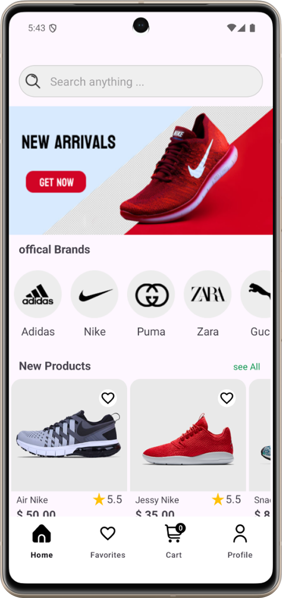
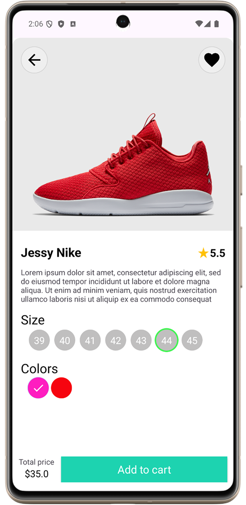
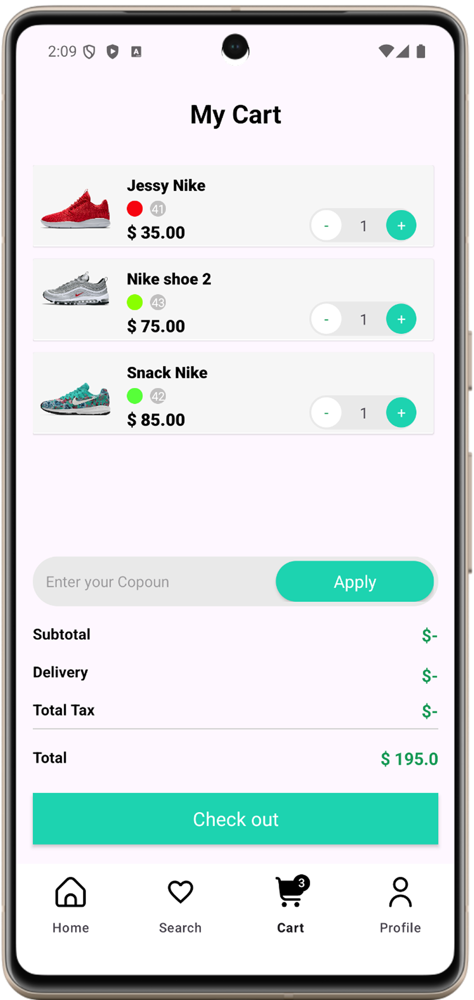

# 🛒 EliExpress - Modern E-Commerce Android App


-blue?style=flat-square&logo=android)


**EliExpress** is a feature-rich, production-ready native Android e-commerce application built with modern Android development practices, clean architecture principles, and robust third-party integrations. It offers a seamless shopping experience from user authentication and product discovery to secure checkout and order tracking.

---

## 📱 Screenshots

| Home & Discover | Product Details | Cart Management |
| :---: | :---: | :---: |
|  |  |  |

---

## ✨ Features

- **🔐 User Authentication & Onboarding**:
  - Secure email/password login and registration powered by **Firebase Authentication**.
  - Interactive onboarding introduction slides for new users.
  - Password recovery dialog and input validation checks.
- **🛍️ Product Discovery & Catalog**:
  - Dynamic home screen with banner view pagers and categorized product feeds (Best Deals, Best Products, Special Products).
  - Robust search functionality to quickly find items.
  - Category-based filtering.
- **🔍 Detailed Product Views**:
  - High-resolution image sliders and galleries.
  - Custom product variant selection (sizes, colors, and stock availability).
  - Quick addition to favorites and shopping cart.
- **❤️ Wishlist & Favorites**:
  - Save favorite products for quick access and later purchase.
- **🛒 Cart Management**:
  - Real-time cart item management (increment, decrement, and remove items).
  - Live subtotal and shipping cost calculations.
- **💳 Secure Checkout & Payments**:
  - Billing address management and selection.
  - Seamless secure payment processing integrated with **Stripe Android SDK**.
- **📦 Order History & Tracking**:
  - Comprehensive order placement and history tracking.
  - Visual order status tracker (Ordered, Packed, Shipped, Delivered) using interactive step views.
- **👤 User Profile Management**:
  - View and edit account details, manage shipping addresses, and securely log out.

---

## 🛠️ Tech Stack & Libraries

- **Language**: [Kotlin](https://kotlinlang.org/)
- **UI & Layouts**: XML Layouts, ViewBinding, ViewPager2, RecyclerView, ConstraintLayout, CircleImageView, StepView
- **Architecture**: **MVVM (Model-View-ViewModel)** with Repository Pattern
- **Dependency Injection**: [Dagger Hilt](https://dagger.dev/hilt/)
- **Backend & Database**: 
  - [Firebase Authentication](https://firebase.google.com/docs/auth)
  - [Cloud Firestore](https://firebase.google.com/docs/firestore)
  - [Firebase Storage](https://firebase.google.com/docs/storage)
- **Networking**: [Retrofit 2](https://square.github.io/retrofit/) & Gson Converter
- **Payments**: [Stripe Android SDK](https://stripe.com/docs/mobile/android) (`stripe-android`)
- **Concurrency & Lifecycle**: Kotlin Coroutines, LiveData, ViewModel, Lifecycle Scopes
- **Image Loading**: [Glide](https://github.com/bumptech/glide)

---

## 🏛️ Architecture & Project Structure

EliExpress follows the **MVVM architectural pattern**, ensuring clear separation of concerns, testability, and maintainability:

```text
com.example.ecommerceapp
│
├── activity/       # Host Activities (MainActivity, ShoppingActivity)
├── adapter/        # RecyclerView & ViewPager Adapters for lists & carousels
├── data/           # Data models (Product, CartProduct, Order, Address, User, etc.)
├── di/             # Dagger Hilt Dependency Injection modules (AppModule)
├── dialog/         # Custom dialogs (e.g., ResetPasswordDialog)
├── firebase/       # Firebase helper utilities (FirebaseCommon)
├── fragment/       # UI Fragments grouped by feature (loginregister, settings, shopping)
├── helper/         # Calculators and business logic helpers
├── remote/         # Retrofit API interfaces
├── util/           # Constants, resource wrappers, validation checks, and item decorations
└── viewmodel/      # ViewModels handling business logic & UI state for each screen
```

---

## ⚙️ Requirements

- **Android Studio**: Koala, Ladybug, or newer.
- **JDK**: Java 8 / 17 compatibility.
- **Min SDK**: 30 (Android 11 or higher).
- **Compile SDK**: 35.
- **Firebase Project**: A configured Firebase project with Firestore, Authentication, and Storage enabled.
- **Stripe Account**: Valid Stripe publishable/secret API keys for test payments.

---

## 🚀 Installation & Setup

1. **Clone the repository**:
   ```bash
   git clone https://github.com/your-username/ecommerce-app.git
   ```
2. **Open in Android Studio**:
   - Launch Android Studio and select **Open**.
   - Navigate to the cloned `E-commerceApp` directory and click **OK**.
3. **Configure Firebase**:
   - Create a project on the [Firebase Console](https://console.firebase.google.com/).
   - Download your `google-services.json` configuration file.
   - Place `google-services.json` inside the `app/` directory (`app/google-services.json`).
4. **Configure Stripe**:
   - Add your Stripe publishable keys where required in your payment manager / configuration constants.
5. **Sync Gradle**:
   - Click **Sync Project with Gradle Files** in Android Studio.
6. **Run the App**:
   - Connect an Android device or start an emulator (API 30 or higher) and click **Run**.

---

## 🔮 Future Improvements

- [ ] **Jetpack Compose Migration**: Gradually migrate legacy XML layouts to modern declarative Jetpack Compose UI.
- [ ] **Offline Caching**: Implement local caching using [Room Database](https://developer.android.com/training/data-storage/room) for seamless offline browsing.
- [ ] **Push Notifications**: Integrate Firebase Cloud Messaging (FCM) for order status updates and promotional alerts.
- [ ] **Dark Mode Support**: Add full dark theme compatibility across all screens.
- [ ] **Automated Testing**: Expand unit tests for ViewModels/Repositories and add UI instrumentation tests (Espresso/Compose UI Test).

---

## 📄 License

```text
MIT License

Copyright (c) 2026 EliExpress

Permission is hereby granted, free of charge, to any person obtaining a copy
of this software and associated documentation files (the "Software"), to deal
in the Software without restriction, including without limitation the rights
to use, copy, modify, merge, publish, distribute, sublicense, and/or sell
copies of the Software, and to permit persons to whom the Software is
furnished to do so, subject to the following conditions:

The above copyright notice and this permission notice shall be included in all
copies or substantial portions of the Software.

THE SOFTWARE IS PROVIDED "AS IS", WITHOUT WARRANTY OF ANY KIND, EXPRESS OR
IMPLIED, INCLUDING BUT NOT LIMITED TO THE WARRANTIES OF MERCHANTABILITY,
FITNESS FOR A PARTICULAR PURPOSE, TITLE AND NON-INFRINGEMENT. IN NO EVENT SHALL
THE AUTHORS OR COPYRIGHT HOLDERS BE LIABLE FOR ANY CLAIM, INCLUDING BUT NOT LIMITED TO THE WARRANTIES OF MERCHANTABILITY,NETIFTY, codebase, or liability, whether IN...
```
